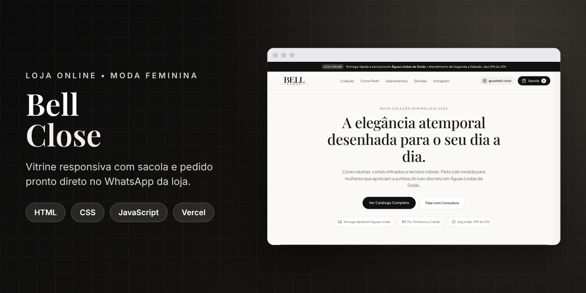
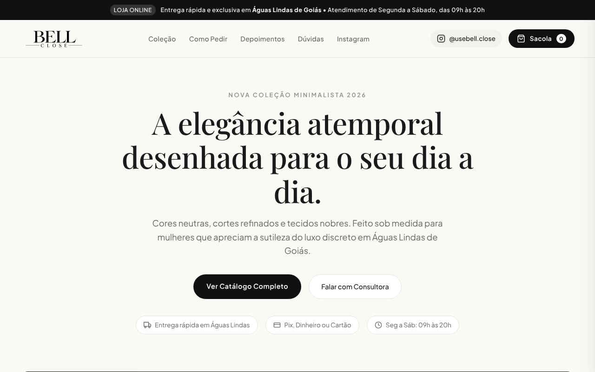
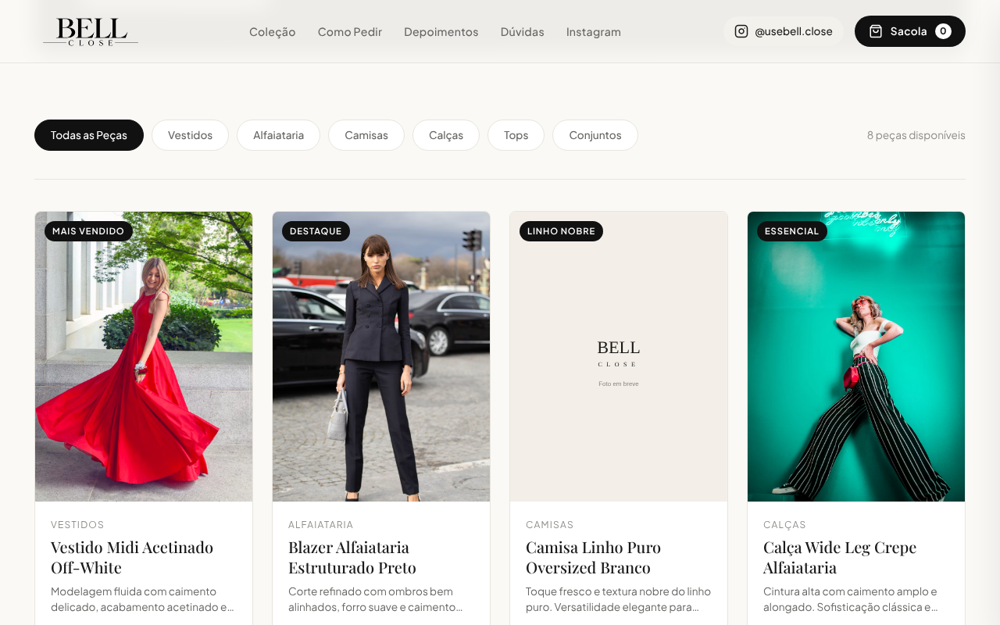
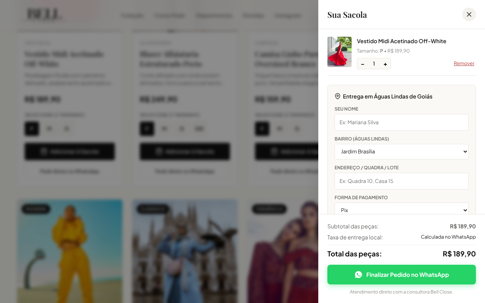
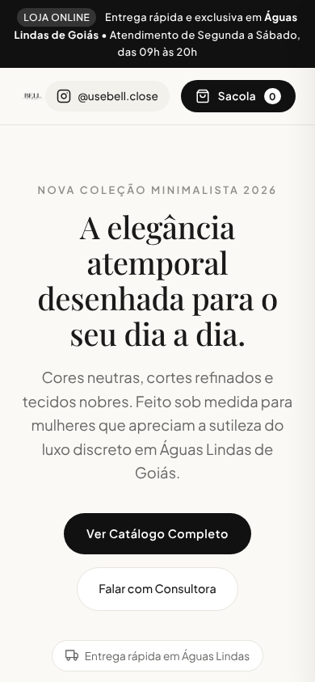

<p align="center">
  
</p>

<h1 align="center">🛍️ Bell Close — Loja Online de Moda Feminina</h1>

<p align="center">
  Vitrine digital responsiva para a <b>Bell Close (@usebell.close)</b>: catálogo com filtros, sacola de compras
  e pedido montado automaticamente e enviado para o <b>WhatsApp</b> da loja.
</p>

<p align="center">
  <a href="https://bellclose.vercel.app"></a>
  
  
  
  
</p>

<p align="center">
  <a href="#-sobre-o-projeto">Sobre</a> •
  <a href="#-funcionalidades">Funcionalidades</a> •
  <a href="#-telas">Telas</a> •
  <a href="#-como-executar">Como executar</a> •
  <a href="#-como-atualizar-o-estoque">Estoque</a> •
  <a href="#-testes-automatizados">Testes</a> •
  <a href="#-estrutura-do-projeto">Estrutura</a>
</p>

---

## 📌 Sobre o projeto

A Bell Close é uma loja **100% online** de moda feminina minimalista, com entregas exclusivas em
**Águas Lindas de Goiás (GO)**. Antes, as vendas eram feitas por fotos soltas no Direct e no WhatsApp, o que gerava
perguntas repetidas sobre preço e tamanho e pedidos incompletos.

O site resolve isso: a cliente escolhe as peças e o tamanho, informa bairro, endereço e forma de pagamento, e o
pedido chega **pronto e estruturado** no WhatsApp da loja. Sem login, sem mensalidade de plataforma e sem taxa sobre
as vendas.

## ✨ Funcionalidades

| | Recurso | Descrição |
|---|---|---|
| 🧾 | **Catálogo dinâmico** | Produtos gerados a partir de um único arquivo (`js/stock.js`) |
| 🏷️ | **Filtros por categoria** | Vestidos, Alfaiataria, Camisas, Calças, Tops e Conjuntos |
| 📏 | **Seleção de tamanho** | P, M, G e GG, conforme a disponibilidade de cada peça |
| 🚫 | **Controle de esgotados** | Peça esgotada mostra o aviso e troca a compra por "consultar reposição" |
| 👜 | **Sacola lateral** | Adicionar, alterar quantidade, remover e ver o subtotal |
| 📍 | **Dados de entrega** | Bairros de Águas Lindas, endereço e forma de pagamento (Pix, cartão ou dinheiro) |
| 💬 | **Pedido no WhatsApp** | Mensagem montada automaticamente com itens, tamanhos, total e dados da cliente |
| ⚡ | **Compra rápida** | Botão "Pedir direto no WhatsApp" em cada peça |
| 📱 | **Responsivo** | Pensado primeiro para o celular, de onde vem a maior parte das clientes |
| 🖼️ | **Imagem de reserva** | Se uma foto falhar, aparece uma imagem neutra da marca no lugar do ícone quebrado |

## 🖼️ Telas

<table>
  <tr>
    <td align="center"><b>Página inicial</b><br></td>
    <td align="center"><b>Catálogo</b><br></td>
  </tr>
  <tr>
    <td align="center"><b>Sacola e dados de entrega</b><br></td>
    <td align="center"><b>Celular</b><br></td>
  </tr>
</table>

## 🚀 Como executar

O site é estático: não tem build nem dependências.

```bash
git clone https://github.com/kauaxp77/Bell_close.git
cd Bell_close
```

Depois, abra o `index.html` no navegador. Se preferir um servidor local:

```bash
npx serve .
```

**Publicação:** cada `git push` na branch `main` atualiza o site na [Vercel](https://bellclose.vercel.app)
automaticamente. O `.vercelignore` impede que testes, documentação e arquivos de configuração sejam publicados.

## 📦 Como atualizar o estoque

Toda a gestão de produtos fica **só** no arquivo [`js/stock.js`](js/stock.js). Não é preciso mexer no HTML nem no CSS.

| Quero... | Faça isto |
|---|---|
| Marcar como **esgotada** | `inStock: true` → `inStock: false` |
| Mudar o **preço** | Altere `price: 189.90` (o card, a sacola e a mensagem do WhatsApp atualizam juntos) |
| Mudar os **tamanhos** | Edite a lista `sizes: ['P', 'M', 'G', 'GG']` |
| Adicionar uma **peça** | Copie um bloco de `BELL_CATALOG`, cole no fim com um `id` novo e preencha os dados |
| Remover uma **peça** | Apague o bloco dela |

Exemplo de peça:

```javascript
{
  id: 'prod-9',
  name: 'Saia Midi Linho Cru',
  category: 'Vestidos',      // Vestidos, Alfaiataria, Camisas, Calças, Tops ou Conjuntos
  price: 169.90,
  sizes: ['P', 'M', 'G'],
  inStock: true,
  tag: 'Lançamento',
  description: 'Cintura alta com caimento leve e tecido fresco.',
  image: 'https://...'
}
```

> ⚠️ Não use `export` no `js/stock.js`. O arquivo é carregado como script comum pelo navegador, e `export` faz a
> vitrine abrir vazia. O teste `stock.test.js` acusa esse erro.

Depois de editar, rode os testes e publique:

```bash
npm test
git add js/stock.js
git commit -m "chore: atualiza estoque"
git push
```

## ✅ Testes automatizados

```bash
npm test
```

São **15 testes** com o executor nativo do Node (`node:test`), sem instalar nada. Eles verificam:

- o catálogo carregando do mesmo jeito que no navegador, com IDs únicos, categorias válidas, preços e tamanhos;
- os cálculos da sacola (adicionar, alterar quantidade, remover e total);
- a mensagem e o link do WhatsApp;
- a presença dos arquivos essenciais e das tags do `index.html`.

## 📁 Estrutura do projeto

```
Bell_close/
├── index.html              # Página da loja: vitrine, sacola, depoimentos, dúvidas e WhatsApp
├── css/
│   └── style.css           # Estilos, cores da marca e responsividade
├── js/
│   ├── stock.js            # 📦 Catálogo e estoque (único arquivo a editar no dia a dia)
│   └── cart.js             # Regras da sacola e da mensagem do WhatsApp
├── images/
│   ├── logo.png            # Logotipo usado no site
│   ├── logo-original.pdf   # Arquivo original da identidade visual
│   ├── favicon.png         # Ícone da aba do navegador
│   └── sem-foto.svg        # Imagem de reserva quando uma foto não carrega
├── tests/                  # Testes automatizados (node:test)
├── docs/                   # Banner e capturas de tela deste README
├── package.json            # Script de testes
├── vercel.json             # Configuração da Vercel
└── .vercelignore           # O que não deve ir para o site publicado
```

## 🛠️ Tecnologias

- **HTML5, CSS3 e JavaScript**, sem frameworks
- **Vercel**: hospedagem estática com HTTPS
- **WhatsApp (wa.me)**: recebimento dos pedidos
- **Node.js (`node:test`)**: testes automatizados

## 👨‍💻 Autor

Desenvolvido por **[kauaxp77](https://github.com/kauaxp77)** para a Bell Close • Águas Lindas de Goiás — GO

<p align="center">⭐ Se curtiu o projeto, deixe uma estrela!</p>
